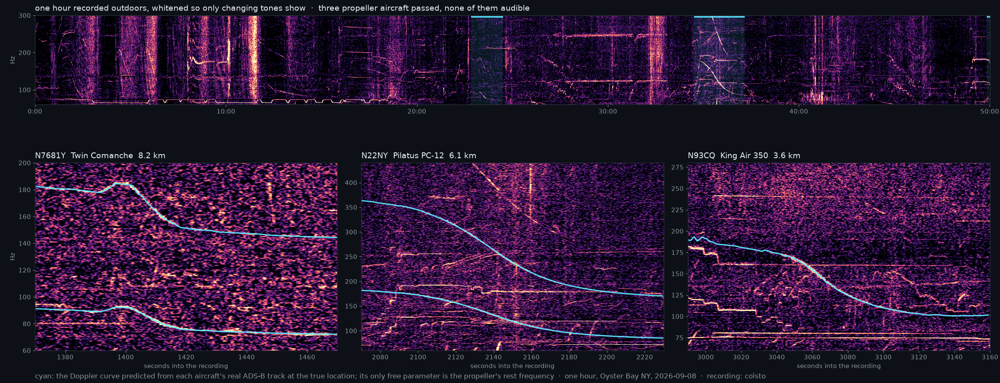

# dopplertrack



Acoustic geolocation from the Doppler curves of propeller aircraft.

Any outdoor (and many indoor) recordings contain faint, usually inaudible
tones from aircraft flying over: the propeller blade-pass fundamental and its
harmonics, between roughly 60 and 400 Hz. As the aircraft passes, the tone
sweeps down in frequency. The exact shape of that sweep depends on where the
listener was relative to the aircraft's real trajectory. With historical
ADS-B data for every flight that day, each candidate location on the ground
predicts a different curve, and the recording picks out the one that matches.

This is a reimplementation of the technique shown in colsto's video
["I discovered a sound that leaks your exact location"](https://www.youtube.com/watch?v=UytYrhYLOKI).
No code was released with that video; this project is an open, automatic
version of the method, with the search extended from a hand-drawn box to a
whole continent.

## Status

Validated on two recordings with known answers: the video author's one-hour
reference clip (Oyster Bay, NY, 2026-09-08) and a 12-hour public eagle-cam
stream (North Fort Myers, FL, 2024-12-28). Both are searched against every
propeller flight over the continental US that day, with no region given.

| | Oyster Bay | eagle cam |
|---|---|---|
| flights that day, CONUS | 35,427 | 13,046 |
| flight pairs scored | 9,669 | 13,298 |
| rank of the true pair, two events | **1** | 15 |
| rank with further detected flyovers (`--extra`) | 1 | **1** |
| best point from the truth | 32 m | 627 m |
| margin over the runner-up | 24 % | 13 % |
| verdict (p) | located (0.001) | located (0.06) |
| verdict from the two events alone | ambiguous (0.23) | ambiguous (0.48) |
| wall time, 16 threads, after the index | 18 min | 6 min |

A third recording, 12 hours from a railway camera in Atlanta searched the
same way, is a negative: every pair of real flyovers puts the camera within
440 m and in the top 6–32 of tens of thousands of pairs, and none wins,
because the modelled curve of the true track has a kink the audio lacks and
a smoother track elsewhere fits better. Its archived stream had also lost
107 s in the middle, which put the extra flyovers on a different clock. The
details and what they add to the roadmap are in the experiments page.

Two flyovers locate a recording when at least one passed low and to the side;
two high, nearly overhead passes leave a plateau a few kilometres wide and a
continent full of pairs that fit, which is what the extra flyovers are for.
A margin is not a confidence: a box that does not contain the answer still
returns a winner. So every search ends with a verdict: the winner is judged
against the thousands of wrong pairs the same search scored on the same
audio, and p is the chance a wrong winner would lead the next wrong pair by
that much. The audio searched in a box 150 km from the answer gets
"no match" (p = 0.88); of twenty searches of the railcam audio with no right
answer among the pairs, two were called located, so p < 0.1 is a weak claim. The experiments behind these numbers, the regional
searches that came first, and the failures along the way are in
[docs/experiments.md](docs/experiments.md).

## Usage

```bash
uv sync
uv run dopplertrack spectrogram recording.mp4 rec.npz
uv run dopplertrack detect rec.npz --band 60 300 --top 10 --out detected.json
uv run dopplertrack fit rec.npz --window 2090 2200 --band 95 200 --harmonics 2 --out ev1.json
uv run dopplertrack fit rec.npz --window 3020 3130 --band 95 195 --out ev2.json
uv run dopplertrack fetch 2026-09-08 day.npz --bbox 24 50 -125 -66          # one index per day, reused by every search
uv run dopplertrack search rec.npz --events ev1.json ev2.json --day day.npz --harmonics 2 1 \
    --cands cands.npz --extra ev3.json ev4.json --out results.csv
uv run dopplertrack refine rec.npz results.csv --events ev1.json ev2.json --day day.npz \
    --harmonics 2 1 --extra ev3.json ev4.json --out fine.csv
```

- `spectrogram` decodes any audio or video with ffmpeg and whitens a
  high-resolution STFT of the 40–450 Hz band per frequency bin, so only
  changing tones stand out.
- `detect` finds the flyovers: an ideal straight-pass Doppler curve (f0,
  speed, CPA distance, CPA time) is grid-searched in a sliding window and the
  local maxima are refined and ranked. `fit` does the same in one window you
  choose. Either writes event JSON that `search` takes as it is.
- `fetch` streams one day of [adsb.lol](https://github.com/adsblol/globe_history_2026)
  history from GitHub (4 GB, nothing stored), drops known jets, and writes the
  day index a search runs on: every flight resampled to 1 Hz in one
  Earth-centred frame, plus a sample per flight per 10 s. `--bbox` limits it
  to a region, `--archive DIR` reads an archive already on disk.
- `search` ranks (location, flight pair) candidates over the index, see
  below. `--bbox` restricts it to a region, `--point LAT LON` scores one
  known location (the quickest check on a recording whose answer you know),
  and one event with `--utc TIME` searches a single flyover whose time is
  known. `--cands` caches the candidate table, so a change to the scorer
  reruns only the scoring. `--extra` rescores the best pairs with further
  flyovers.
- `refine` lays a 50 m grid around one result, optionally with more events.

Around those six, tools for the rest of the video's workflow and its countermeasures
(details, and how each did on real data, in [docs/video-method.md](docs/video-method.md)):

```bash
# the video's "Building the Doppler Curve, Step by Step" panel for one flight, observer and time
uv run dopplertrack explain --day day.npz --icao ace391 --point 40.876466 -73.524951 \
    --utc 2026-09-08T21:08:43 --f0 104 --plot panel.png
# score a faint curve by its distance from a traced line, as the video does
uv run dopplertrack trace-line rec.npz ev_faint.json --csv my_trace.csv --harmonic 2
uv run dopplertrack search rec.npz --events ev_faint.json --utc 1788900058.6 --day day.npz --score line --out single.csv
# the atmosphere: per-ray sound speed from the hour's temperature profile, and wind
uv run dopplertrack search ... --weather          # or --temp 24 --lapse, --wind 4 200
# paths that curve between ADS-B reports, baro-only altitudes on the GNSS datum
uv run dopplertrack fetch 2026-09-08 day.npz --bbox 40.4 41.3 -74.4 -72.6 --interp hermite --calibrate-baro
# look at the answer: Street View links for every candidate, and the figures
uv run dopplertrack export results.csv candidates.html --truth 40.876466 -73.524951
uv run dopplertrack plot candidate cand.png --spec rec.npz --results results.csv --events ev1.json ev2.json --day day.npz
# does a recording leak its location, and remove the leak
uv run dopplertrack audit rec.npz --band 60 300 --out leaks.json
uv run dopplertrack scrub recording.mp4 clean.wav --events leaks.json --band 60 300
```

Heights: ADS-B geometric altitude is height above the WGS-84 ellipsoid and terrain is height
above sea level. `--geoid` on `fetch`, `search` and `refine` puts observers (and baro-only
aircraft) on the ellipsoid with the EGM96 geoid (about 33 m around New York); it is off by
default, as the saved results were made.

## How the search works

1. **Join.** Two events heard Δt apart at fitted slant distances d1 and d2
   mean the two aircraft were within d1 + d2 of each other, Δt apart in
   emission time (give or take the propagation delays). That is a join over
   the day's 10 s samples with KD-trees, speed-gated, and it leaves a few
   tens of thousands of flight pairs out of hundreds of millions.
2. **Lens.** For each pair, ground points are laid only where both flights
   could have been heard: a 1 km lattice first, then 200 m where it passes.
   Every point gets the exact closest point of approach to each real
   trajectory: slant distance (with a DEM for the observer's elevation),
   speed, and the *heard* CPA time. Points must hear an event-1-like pass,
   then exactly Δt later an event-2-like pass, with no other propeller
   flight within 6 km in between.
3. **Score.** The Doppler curve each survivor would hear is modelled from the
   real trajectory (emission-time radial velocity) and scored against the
   spectrogram. Event 1's placement is swept over small time shifts and f0
   scales, which absorb measurement error; event 2 is placed with the same
   shift, locked to the flight geometry. Score = brightness under both curves.
4. **More events.** For the best pairs, each further flyover is matched to a
   flight at the pair's best point and scored at all of its points with that
   point's shift, so every event is on one clock. `refine` does the same on
   a fine grid.
5. **Verdict.** At most one scored pair is right; the rest are the null
   distribution for this recording. The upper tail of their scores is fitted
   as exponential, and the gap between the winner and the best other pair is
   tested against it: located (p < 0.1), ambiguous (p < 0.5), or no match.

The ideal-curve fits only seed the gates (`--v-tol`, `--d-tol`; open them
for a faint or turning pass); ranking uses real trajectories throughout.
`--score ridge` scores how closely a curve follows the ridge traced in the
window instead of the brightness under it.

## Differences from the method in the video

The physics and the search strategy are the author's. What differs:

- **Automatic curve measurement.** The video slides f0, speed, distance and
  CPA time by hand until the overlay looks right. `fit` and `detect` do it
  with a grid search plus Nelder-Mead on the whitened window.
- **Pairs of flights, not points along one flight.** The video lays points
  along every flight matching event 1 at the fitted distance and tests them
  for event 2, which needs tight hand-fitted ranges. Joining flight pairs on
  the geometry of both events first stays cheap under the wide gates an
  automatic fit needs; with tight gates it reduces to the video's method.
- **Harmonic-aware fitting and scoring**, where a flyover shows a second
  harmonic.
- **Open data path.** adsb.lol daily archives, ICAO Doc 8643 engine classes
  and AWS terrain tiles, each with a loader; nothing scraped or paid.
- **One command for every search.** A box, a known point, or one flyover
  with a known time are options on the same search, not separate methods.

Kept on purpose: emission-time radial velocity, propagation-delayed CPA
times, slant distance with a DEM, the inter-event offset filter, the silence
filter, and locked two-event scoring.

## Data sources (all free)

Also used by the additions in docs/video-method.md: NGA's EGM96 geoid (public domain, via
PROJ-data on GitHub), Open-Meteo's historical forecast archive for temperature and wind
profiles (CC BY 4.0), and the Livermore flyover dataset (Pathak 2026, Zenodo 23424278,
CC BY 4.0) for `benchmarks/livermore.py`.


| Need | Source |
|---|---|
| Historical ADS-B | adsb.lol `globe_history_YYYY` GitHub releases (~4 GB/day) |
| Aircraft engine class | OpenSky mirror of ICAO Doc 8643 |
| Elevation | AWS Terrain Tiles (Terrarium) |

## Development

```bash
uv run pytest
```

The suite runs on synthetic flights in about three minutes. The Oyster Bay
check against the real recording is opt-in: set `DOPPLERTRACK_OYSTER_BAY`
to a directory holding `rec.npz` and `traces_ny.npz` (see
`tests/test_oyster_bay.py`). The original design notes are in
`docs/superpowers/specs/`; [CHANGELOG.md](CHANGELOG.md) lists the changes
per release.

## Releasing

Pushing a tag `vX.Y.Z` that matches the version in `pyproject.toml` runs
`.github/workflows/release.yml`: tests, sdist and wheel, a GitHub Release
with generated notes, and PyPI through trusted publishing.

```bash
uv version 0.3.0            # bump pyproject.toml
git commit -am "Release 0.3.0"
git tag v0.3.0 && git push && git push --tags
```
