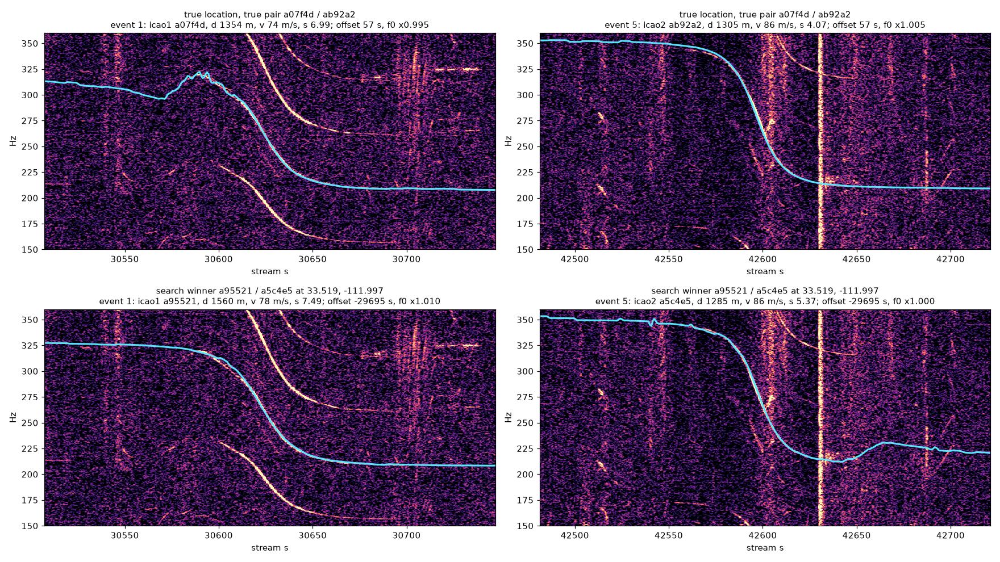

# Experiments

What was tried on the way to the search in the README, with the numbers.
Paths are relative to the repository root. The regional results were made
with the grid search of versions 0.1 and 0.2 (a 200 m grid over a box, every
grid point against every flight); since 0.3 `search --bbox` runs the same
test through the flight-pair join, and the commands below are written for
the current CLI.

## Oyster Bay: the reference recording

colsto's raw one-hour clip ([youtu.be/4CxVxuMVkMc](https://youtu.be/4CxVxuMVkMc)),
made 2026-09-08 in Oyster Bay, NY at 40.876466, -73.524951, the answer given
in the video. Only the recording date was used as an input; the clip's start
time (20:17:30 UTC) and the two aircraft fall out of the search.

**Known-point check.** Scoring the true location (`search --point`) against
every non-jet flight of the day touching a 100 x 150 km box (1,016 traces)
leaves exactly one pair that passes the 918 s offset and silence filters:
N22NY, a Pilatus PC-12 at 6.1 km, heard CPA 20:53:25 UTC, and N93CQ, a King
Air 350 at 3.6 km, 21:08:43 UTC. The Doppler curves modelled from their real
trajectories lie on the measured ridges with no free parameters beyond a
half-second time shift:


The two event fits are [`results/oyster_bay_ev1.json`](results/oyster_bay_ev1.json)
and [`results/oyster_bay_ev2.json`](results/oyster_bay_ev2.json), from

```bash
dopplertrack fit rec.npz --window 2090 2200 --band 95 200 --harmonics 2 --out ev1.json
dopplertrack fit rec.npz --window 3020 3130 --band 95 195 --out ev2.json
```

**Regional blind search.** A 200 m grid over the 100 x 150 km box (379,758
points, 3,068 airborne flight segments) gives 86 million (point, flight)
closest approaches and 40,889 candidate (point, pair) triples after the
filters, from 328 distinct flight pairs; 19 minutes on a laptop.

| | |
|---|---|
| Rank of the true location's flight pair | 1 of 328 |
| Top candidate, 200 m grid | 123 m from truth |
| Refined peak, 50 m grid | 43 m from truth |
| Margin over the best wrong flight pair | 4.9 % (27.1 vs 25.8) |


The 50 m refinement shows a single clean peak. The 4.9 % margin over the
runner-up pair (flights 70 km away whose geometry happens to produce a
similar 918 s offset) is thin, because the score only measures brightness
under the modelled curve, so a wrong pair can score well wherever the
spectrogram is busy. Tables:
[`results/oyster_bay_search_best_per_pair.csv`](results/oyster_bay_search_best_per_pair.csv)
(best score per flight pair) and
[`results/oyster_bay_refined_50m.csv`](results/oyster_bay_refined_50m.csv).

**A margin is not a confidence.** The same audio searched in a box moved
150 km north, which cannot contain the answer, still returns a winner: 38
flight pairs, the best 152 km from the truth with a 1.5 % margin, and nothing
in the output says it is wrong (found by SokolskyNikita in
[issue #4](https://github.com/mjshiggins/dopplertrack/issues/4), reproduced
here; [`results/oyster_bay_moved_box_best_per_pair.csv`](results/oyster_bay_moved_box_best_per_pair.csv)).
The nationwide search removes the box but not the problem; the verdict
below is the answer to it.

**Automatic event detection.** The two windows above were chosen by eye, as
in the video. `detect` over the whole hour with no hints returns the same two
flyovers as its top two candidates (CPA 2155.6 s and 3068.4 s, scores 15.7
and 10.0; the third candidate scores 9.0;
[`results/oyster_bay_detected.json`](results/oyster_bay_detected.json)).
Its own fits of them cannot yet stand in for `fit`: its event 2 comes out
with f0 11 % above what the King Air's trajectory needs and the time between
the two events 10 s short, so the search's ±6 s and ±5 % filters reject the
true pair at the true location ([issue #1](https://github.com/mjshiggins/dopplertrack/issues/1)).
Finding the flyovers needs no manual input; measuring them for the search
still uses the two `fit` windows.

## The eagle cam: a 12-hour public stream

To test on something the method was not developed on: the Southwest Florida
Eagle Cam in North Fort Myers (nest LE-026B at 26.702359, -81.847766 in Lee
County's eagle-nest register), the 12-hour archive of 2024-12-28
([youtu.be/zs2o5Rhlp5w](https://youtu.be/zs2o5Rhlp5w)). A harder recording:
an outdoor microphone in wind, 12 hours long, and 10 km from a busy
flight-school airport, so prop aircraft pass every few minutes. The day's
ADS-B was streamed (557 non-jet flights touching a 130 x 130 km box) and
the flyovers were found with `detect`
([`results/swfl_detected.json`](results/swfl_detected.json)): of its top 40
candidates, 20 coincide within 25 s with a known prop flight passing within
12 km of the nest.


**Regional blind search** on two detected events 338 s apart (a Beech Baron
at 2.5 km and a Pilatus PC-12 at 6 km, as it turns out) over the box:
432,196 points, 1,233 flight segments, 50,682 candidate triples from 607
flight pairs, 8 minutes.

| | |
|---|---|
| Rank of the true flight pair | 1 of 607 |
| Margin over the best wrong pair | 2.5 % |
| Top candidate, 200 m grid, two events | 917 m from the nest |
| Refined peak, 50 m grid, two events | 1.7 km from the nest |
| Refined peak with three more detected flyovers | 592 m from the nest |


The right flights are identified, but two events pin the location only to
about 2 km, and the reason is geometry rather than noise: both aircraft
passed nearly overhead at 2.5 km and 5.7 km altitude, so the slant distance
that shapes the Doppler curve barely changes as the observer moves a
kilometre on the ground. At Oyster Bay the King Air passed 3.5 km to the
side at 1 km altitude, which is why that peak is sharp. Adding three more
flyovers found by `detect` (`refine --extra`), locked to the same clock,
brings the peak to 592 m. Lower, lateral passes are what pin a location, so
the more flyovers a long recording offers, the better. Tables:
[`results/swfl_search_best_per_pair.csv`](results/swfl_search_best_per_pair.csv),
[`results/swfl_refined_50m.csv`](results/swfl_refined_50m.csv).

**What this second recording changed.** The first version of the scorer
averaged brightness only over the part of the window a modelled curve
covered, so a flight that landed or left the data mid-pass was judged on its
bright half alone; on the eagle cam that put a pair 64 km away on top. The
score is now the brightness summed along the curve over the whole measured
window (uncovered parts count as zero), which fixed the ranking here and
left the Oyster Bay result unchanged. Scoring the curve against its spectral
neighbourhood (a contrastive score) was tried as well: it widens the Oyster
Bay margin to 8.9 % but does not help the eagle cam, so it is not in.

## A faint single flyover with a known time

The video's last experiment locates the recording from one faint one-minute
curve, given its time. The Oyster Bay hour has such a curve at 1375–1465 s:
a fundamental sweeping 92 to 73 Hz a few dB above the noise, with its second
harmonic ([`results/oyster_bay_ev_faint.json`](results/oyster_bay_ev_faint.json)).
The only ADS-B flight passing the true point then is N7681Y, a Piper Twin
Comanche, whose heard CPA at the true point is 0.9 s from the fitted one.
Its curve modelled from the real trajectory sits on the faint ridge
([figure](results/oyster_bay_faint_curve.png)), but the straight-pass fit of
that ridge says 41 m/s at 750 m where the aircraft was doing 70 m/s at
8.2 km: a sharp drop followed by a flat tail reads as a close slow pass, and
the default gates (±35 % in speed, 0.4–2.5× in distance) drop the true
flight before scoring. With the gates opened, one event and its heard-CPA
time (20:40:58 UTC) over the same 100 x 150 km box and ±30 s scores 77,280
(point, flight) pairs from 66 flights:

```bash
dopplertrack fit rec.npz --window 1375 1465 --band 70 105 --harmonics 2 --out ev_faint.json
dopplertrack search rec.npz --events ev_faint.json --utc 1788900058.6 --day day.npz \
    --bbox 40.4 41.3 -74.4 -72.6 --harmonics 2 --v-tol 1.0 --d-tol 0.05 20 --out single.csv
```

| score | top point | margin over the next flight | top-20 points on N7681Y | of those within 2 km |
|---|---|---|---|---|
| brightness | 1.7 km from the truth, N7681Y | 31.6 % | 20 | 17 |
| ridge | 2.3 km from the truth, N7681Y | 14.5 % | 20 | 3 |

Tables: [`results/oyster_bay_single_faint_brightness.csv`](results/oyster_bay_single_faint_brightness.csv),
[`results/oyster_bay_single_faint_ridge.csv`](results/oyster_bay_single_faint_ridge.csv).
Two lessons. A single faint flyover with a known time does locate the
recording to a couple of kilometres in a box this size, as the video says
(the clock pins the position along the track only to the time tolerance
times the speed, 3 km at ±30 s). And the ideal-curve fit is the weak link:
on a pass that is not straight it is wrong by a factor of ten in distance,
so the gates it seeds must be loose or, better, replaced by the
trajectory-modelled curve itself.

## Ridge score

For that faint curve the video scores candidates by their distance from a
hand-traced line rather than by brightness. `--score ridge` is the automatic
version: a Viterbi ridge is traced through the event window once (harmonics
are multiples of it), frames are kept only where the ridge is bright and at
least 3 dB brighter than the best path that avoids it (a bird burst or a
second tone offers several equally good paths and says nothing), and a
modelled curve scores the fraction of kept frames it passes within 1.5 % in
frequency of ([tracks and masks](results/ridge_tracks.png)). On the two
regional two-event searches it is not an improvement over brightness, and it
is not the default:

| recording | brightness: true pair rank, margin | ridge: rank, margin |
|---|---|---|
| Oyster Bay (328 pairs) | 1, 4.9 % | 1, 4.0 % |
| eagle cam (607 pairs) | 1, 2.5 % | 4 (1 without the uniqueness mask, 0.6 %) |

Widening the tolerance to 3 % or 5 % or dropping the mask moves the eagle
cam between rank 1 with no margin and rank 4; the pair it loses to is the
one brightness ranks second, two aircraft on the same airway whose curves
differ little. Best-per-pair tables under both scores:
[`results/oyster_bay_search_best_per_pair_ridge.csv`](results/oyster_bay_search_best_per_pair_ridge.csv),
[`results/swfl_search_best_per_pair_ridge.csv`](results/swfl_search_best_per_pair_ridge.csv).
What the ridge score does give is a score in [0, 1] with a meaning (the
share of the measured curve the candidate explains) and a per-frame
residual, the raw material for an uncertainty estimate.

## Nationwide search

The regional searches above only work because a box was drawn around the
answer. Dropping the box: one day of prop flights over the whole continental
US (35,427 flights, 149 million one-second positions after resampling) is
indexed once, in one Earth-centred frame so slant distances are exact
anywhere, and the Oyster Bay events are searched against all of it with the
default gates.

| stage | Oyster Bay day, 16 threads (Ryzen 5800X) |
|---|---|
| `fetch`, prop flights over CONUS, streamed | 2.5 min at 20 MB/s |
| index (1 Hz segments + 10 s samples, 6.2 GB) | 30 s, once per day of data |
| pair join (speed gates, distance + lag geometry) | 10 s → 66,637 flight pairs |
| lens lattices, exact CPA, gates, silence filter | 71 s → 2,479,072 points on 9,963 pairs |
| locked scoring | 16 min |
| `--extra`, one more flyover on the top 200 pairs | 1 s |

A scorer change reruns only the scoring (`--cands` caches the candidate
table); a gate change reruns the join and the lens as well.

Result: the true pair N22NY / N93CQ ranks **1 of 9,669** flight pairs, its
best 200 m lattice point **32 m** from the true location, with a 6.2 %
margin over the runner-up (a pair over Texas). The next pair within 100 km
of the truth ranks 3rd. The best point of every pair is in
[`results/oyster_bay_wide_best_per_pair.csv`](results/oyster_bay_wide_best_per_pair.csv)
(top 1,000 of 9,669). Adding the faint flyover above as an extra
(`--extra ev_faint.json --extra-harmonics 2`) widens the margin to 24 %, and
the flight it matches to that event at the true point is N7681Y, the Twin
Comanche found there by hand.

**The eagle cam, nationally.** The same search over 2024-12-28 (13,046 prop
flights; 102,941 pairs joined in 6 s, 1,060,324 points on 13,466 pairs in
29 s, scored in 4.5 min) does *not* locate the camera from its two detected
events alone: the true pair ranks 15 of 13,298, 972 m off, and the winner
pairs the right first flight with a different second flight 200 km away
near Tampa, with a 1.7 % margin
([`results/swfl_wide_best_per_pair.csv`](results/swfl_wide_best_per_pair.csv)).
That is the regional finding writ large: two high, nearly overhead passes
pin a location to about 2 km and a 2.5 % margin in a box, and a continent
offers many pairs that fit two such curves as well.

The extra flyovers that pin the eagle cam regionally do the same
nationally. `--extra` takes the three further detected flyovers that
`refine --extra` used, matches each to a flight at every top pair's best
point, and scores it at all of that pair's points on the same clock. On the
200 best two-event pairs this takes one second, and the true pair moves
from 15th to **first, 627 m from the nest, with a 13 % margin**
([`results/swfl_wide_extra_best_per_pair.csv`](results/swfl_wide_extra_best_per_pair.csv)).
The rescoring only sees the pairs the two-event search ranked in the top
`--top-pairs` (200 by default), so the two events still have to put the
truth somewhere in that list; here they put it 15th.

**What made it feasible.** The join over trajectories replaces the grid: a
box the size of the country at 200 m would be 200 million points times
every flight, while the join touches only pairs whose geometry allows the
two events, and lays points in the lens where both annuli overlap (about
250 points per surviving pair). And the scorer had to be rebuilt for a
process pool: its original form streamed several megabytes of temporaries
per candidate, which an Apple-silicon laptop hides and a desktop's memory
bus does not (16 workers ran 1.4 times faster than one). Sampling the
spectrogram window along time once per event, so each sweep sample is two
gathers from a 200 KB array, and walking the sweep in small chunks made it
twice as fast on one core and eleven times faster on 16. The lens stage had
the same disease (a dense point-by-track distance matrix per pair) and the
same cure: a KD-tree nearest-sample query gives the identical CPA with no
large temporaries, and 12 minutes became 71 seconds.

## Confidence from the null

Every search scores thousands of flight pairs, at most one of which is right.
The others are wrong by construction (real aircraft, real geometry that
passed the gates) and were scored against the same audio, so their scores
are what a wrong pair looks like on this recording: the null distribution,
produced for free, and the larger the search the better it is known. The
winner is judged against that crowd instead of against the runner-up alone.

The model (`dopplertrack.verdict`): pairs sharing a flight with the winner
are left out, since they carry part of its signal; the upper tail of the rest
is taken as exponential above the k-th best score (k is 5 % of the wrong
pairs, between 15 and 100), with its mean excess m fitted there; the spacing
between the two largest values of such a tail is itself exponential with mean
m, so the chance that a wrong winner would lead the best other wrong pair by
the observed gap is p = exp(−gap / m). Located below 0.1, ambiguous below
0.5, no match above.

| search | winner | gap / tail width | p | verdict |
|---|---|---|---|---|
| Oyster Bay, nationwide, two events | true pair, 32 m | 1.65 / 1.11 | 0.23 | ambiguous |
| Oyster Bay, nationwide, + faint flyover | true pair, 32 m | 6.92 / 0.75 | 0.0001 | located |
| eagle cam, nationwide, two events | wrong pair, 203 km | 0.19 / 0.26 | 0.48 | ambiguous |
| eagle cam, nationwide, + three flyovers | true pair, 627 m | 2.53 / 0.92 | 0.064 | located |
| Oyster Bay, regional box, two events | true pair, 123 m | 1.28 / 1.55 | 0.44 | ambiguous |
| eagle cam, regional box, two events | true pair, 917 m | 0.25 / 0.31 | 0.44 | ambiguous |
| Oyster Bay, box moved 150 km north | wrong pair, 152 km | 0.32 / 2.59 | 0.88 | no match |

Read across the rows: two events never prove a location, even when they
find it. The 6.2 % margin at Oyster Bay is a gap of 1.5 tail widths, which a
wrong winner leads by one time in four; the eagle cam's two events, which
in fact picked the wrong pair, look the same. The extra flyovers are what
turn a right answer into a provable one, and the moved box, which has no
right answer, is the only case the test rejects outright. These seven tables
are the beginning of the benchmark: `tests/test_verdict.py` checks each
verdict against the saved best-per-pair tables.

## A third recording: a railcam in Atlanta

The two recordings above were both made by someone standing outdoors with the
aircraft in mind. The third was not: Railstream's Howell Wye camera at the BI
Tower junction in Atlanta (YouTube `OH5baHg7pIw`, 11.9 h overnight from
2026-05-28 00:42 UTC, 49 kbps audio), chosen because the camera's position is
known to about 100 m and the ADS-B day is in the archive. A first choice, the
Berea, Ohio camera of 2026-01-26, had to be dropped: 6.9 h of a daytime
snowstorm with one propeller pass within 15 km, and every top detection a
locomotive passing the camera, whose engine tone (190–210 Hz) sweeps like a
140 m/s flyover at 300 m and arrives with a broadband rumble. That is what
the `burst` column of `detect` is for.

**Detection.** 42 propeller passes within 15 km during the stream, 12 of them
within 6 km and below 3 km AGL. Six of `detect`'s top forty are real: ranks
1, 5, 8, 11, 12 and 29 (a07f4d 1.3 km, ab92a2 1.7 km, a1902a 1.8 km, a26439
3.6 km, a6937e 1.8 km, a798b9 6.0 km). Ranks 2, 3 and 4 are not aircraft. A
low, slow aircraft that circled the junction three times at 215 m AGL (aa202a)
was never detected.

**The clock.** Lining the six up with the ADS-B passes gives offsets of +50 s
before 15,400 s of stream and −57 s after 30,600 s: the archived stream lost
about 107 s somewhere in between. A two-event search only needs the interval
between its two events, so a pair on one side of the gap is unaffected, but
any event on the other side is on a different clock, and the extra-flyover
rescoring, which puts every event on the clock of the pair, matches those
to no flight or to the wrong one. Long public streams drop out; the method
has to expect it.

**The blind protocol.** Every pair of the top five detections as the two
events (earlier first), the other burst-free detections among the top twelve
as extras, one nationwide search per pair with the silence filter off, since
on a 12-hour recording of a busy approach corridor two detected flyovers are
rarely consecutive (an undetected 3.9 km pass sits between ranks 1 and 5 and
would have vetoed the truth). Ten searches, about 15 minutes each.

| pair (detect ranks) | truth | pairs scored | two events | with extras |
|---|---|---|---|---|
| 1 + 5 | both real | 36,260 | **true pair rank 6, 361 m**; winner a Scottsdale pair, located (p = 0.08) | true pair rank 68; ambiguous (0.41) |
| 2 + 4 | neither | 54,843 | ambiguous (0.41) | wrong pair located (p = 0.006) |
| 1 + 4, 2 + 5, 3 + 1, 3 + 4, 4 + 5 | one or none | 9,772–85,065 | no match | no match (0.51–0.94), 1 + 4 ambiguous (0.48) |
| 2 + 1, 3 + 2, 3 + 5 | one or none | 37,298–115,864 | ambiguous (0.25–0.44) | no match (0.64–0.81), 2 + 5 ambiguous (0.28) |

So the one pair of real flyovers finds the camera to within 361 m (460 m on
a 50 m grid) in sixth place out of 36,260 pairs over the continent, and
loses to a pair in Scottsdale, Arizona with the same geometry: two passes at
1.5 and 1.3 km at the same speeds, 12.8 against 12.0. The extras, meant to
settle that, were on the wrong clock and buried it instead.

**The verdict under test.** Eighteen of the twenty verdicts came from
searches with no right answer among the scored pairs. Two of them said
located, at p = 0.08 and p = 0.006. One in ten is what a threshold of 0.1
promises, and the first is within it; the second, with extras, is not: the
null there is only the 200 rescored pairs, and nine extras each matched to
the best flight near each point inflate a wrong pair as readily as the right
one. "Located" at p < 0.1 is therefore a weak claim, and the extras need a
clock of their own. The tables are saved as `howell_wye_*` and the two false
positives are expected failures in `tests/test_verdict.py`.

**On one clock.** The three other real detections (ranks 8, 11, 12) are all
before the gap, so their three pairs are a fair test of the search with the
clock intact, with the four non-aircraft detections from the same side of the
gap as extras:

| pair | truth | pairs scored | two events | with four wrong extras |
|---|---|---|---|---|
| 8 + 12 (a1902a, a6937e) | 366 m, rank 16 of 166,583 | ambiguous (0.19) | rank 116 |
| 12 + 11 (a6937e, a26439) | 438 m, rank 12 of 38,878 | no match (0.85) | rank 81 |
| 8 + 11 (a1902a, a26439) | 173 m, rank 32 of 37,028 | ambiguous (0.23) | rank 83 |

Every pair of real flyovers puts the camera within 440 m and in the top 32 of
tens of thousands of pairs, and none of them wins. Extras that are not
aircraft push the right pair down every time: each is matched to the
brightest flight near every candidate point, and the busier the airspace
around a wrong point, the more that selection is worth. Extras help only
when they are real: refined with the one real extra on the same clock, the
8 + 12 pair's true point scores 18.9 against the winner's 17.3 and the
12 + 11 pair's 19.0 against a winner with no flight to match at all. On the
two earlier recordings the extras were real, which is why they looked so
decisive; `detect` alone cannot promise that.



**Why the truth loses.** The figure shows the two events of the blind pair
with the curve each candidate predicts. At the true location the curve
predicted from a07f4d's ADS-B track has a kink before the closest approach
that the audio does not have: the recorded tone sweeps smoothly from 325 to
210 Hz while the modelled one dips and recovers, which is what a glitch or a
gap in the position reports does to a radial velocity taken from
differentiated positions. The Scottsdale pair's smooth track fits the audio
better there (7.5 against 7.0 on event 1) and the margin is the whole
difference. The second thing the figure shows is that the recording holds
three or four harmonics of the same propeller, in fixed ratios, and the
search scores one curve. A wrong pair has to fit one line; it would have to
fit the comb.

What this recording adds to the roadmap: smooth the trajectories before
taking radial velocities (or take them from the reported ground speed and
track); score the harmonic comb, not one curve; give each extra event its
own clock offset, and weigh it by how many flights it had to choose from;
and treat "located" at p < 0.1 as the weak claim it is.
